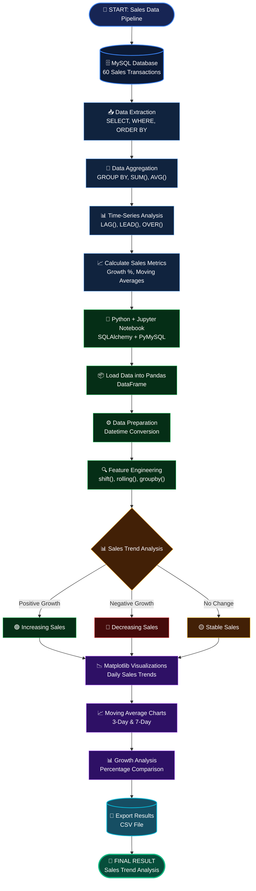

# 📊 Handling Time-Series Data: Daily Average and Trends


## 📌 Project Overview

This project focuses on analyzing time-series sales data using **MySQL and Python (Jupyter Notebook)**.

The main objective is to track daily sales performance, calculate average sales, identify sales trends, and compare sales across consecutive periods using SQL aggregate functions and window functions.

The project also uses Python libraries such as Pandas and Matplotlib to perform data analysis, calculate moving averages, measure sales growth, and visualize sales trends.

## 🎯 Objectives

- Extract time-series sales data from a MySQL database.
- Calculate daily total and average sales.
- Analyze day-over-day sales trends.
- Compare consecutive periods using SQL window functions.
- Calculate sales growth percentages.
- Identify increasing and decreasing sales patterns.
- Calculate 3-day and 7-day moving averages.
- Analyze sales performance using Pandas.
- Visualize sales trends using Matplotlib.
- Export analytical results into CSV format.

## 🛠️ Technologies Used

| Technology | Purpose |
|---|---|
| MySQL | Database management and SQL analysis |
| Python | Data analysis |
| Jupyter Notebook | Interactive development |
| Pandas | Data manipulation and analysis |
| Matplotlib | Data visualization |
| SQLAlchemy | Database connectivity |
| PyMySQL | MySQL connection with Python |

## 📂 Project Structure

```text
5A_Handling_Time_Series_Data_Daily_Average_and_Trends/
│
├── README.md
├── requirements.txt
│
├── SQL/
│   └── sales_analysis.sql
│
├── Python/
│   └── sales_time_series_analysis.ipynb
│
└── Output/
    └── daily_sales_analysis.csv
```

## 🔄 Project Workflow

This project follows an end-to-end data analytics pipeline, starting from sales data storage in MySQL and ending with actionable insights and visualizations using Python.

### 🚀 End-to-End Sales Analytics Pipeline



### Workflow Explanation

1. **MySQL Database:** Stores sales transactions in a structured database.
2. **SQL Queries:** Extracts sales information and performs calculations using aggregate and window functions.
3. **Python + Jupyter Notebook:** Connects Python to MySQL and retrieves sales records.
4. **Pandas Data Analysis:** Performs grouping, previous-day comparisons, moving averages, and growth calculations.
5. **Matplotlib Visualizations:** Creates graphs to understand sales trends and patterns.
6. **Final Result:** Generates sales trend analysis and exports the results into a CSV file.

## 🗄️ MySQL Implementation

### 1. Create Database

```sql
CREATE DATABASE sales_analysis;

USE sales_analysis;
```

### 2. Create Sales Table

```sql
CREATE TABLE sales_table (
    sale_id INT AUTO_INCREMENT PRIMARY KEY,
    sale_date DATE NOT NULL,
    amount DECIMAL(10,2) NOT NULL
);
```

### 3. Calculate Daily Average Sales

Use `AVG()` to calculate the average transaction amount for each day.

```sql
SELECT
    sale_date,
    COUNT(*) AS total_transactions,
    SUM(amount) AS daily_total_sales,
    AVG(amount) AS daily_average_sales
FROM sales_table
GROUP BY sale_date
ORDER BY sale_date;
```

### 4. Analyze Sales Trends Using LAG()

Use `LAG()` to retrieve previous day's sales.

```sql
WITH daily_sales AS (
    SELECT
        sale_date,
        SUM(amount) AS daily_total_sales
    FROM sales_table
    GROUP BY sale_date
)
SELECT
    sale_date,
    daily_total_sales,
    LAG(daily_total_sales) OVER (
        ORDER BY sale_date
    ) AS previous_day_sales
FROM daily_sales
ORDER BY sale_date;
```

### 5. Calculate Sales Difference

Compare current sales with previous day's sales.

```sql
WITH daily_sales AS (
    SELECT
        sale_date,
        SUM(amount) AS daily_total_sales
    FROM sales_table
    GROUP BY sale_date
)
SELECT
    sale_date,
    daily_total_sales,

    LAG(daily_total_sales) OVER (
        ORDER BY sale_date
    ) AS previous_day_sales,

    daily_total_sales -
    LAG(daily_total_sales) OVER (
        ORDER BY sale_date
    ) AS sales_difference

FROM daily_sales
ORDER BY sale_date;
```

### 6. Calculate Sales Growth Percentage

Compare current sales with previous day's sales.

```sql
WITH daily_sales AS (
    SELECT
        sale_date,
        SUM(amount) AS daily_total_sales
    FROM sales_table
    GROUP BY sale_date
),
sales_comparison AS (
    SELECT
        sale_date,
        daily_total_sales,
        LAG(daily_total_sales) OVER (
            ORDER BY sale_date
        ) AS previous_day_sales
    FROM daily_sales
)
SELECT
    sale_date,
    daily_total_sales,
    previous_day_sales,
    ROUND(
        (daily_total_sales - previous_day_sales)
        * 100.0 / NULLIF(previous_day_sales, 0),
        2
    ) AS growth_percentage
FROM sales_comparison
ORDER BY sale_date;
```

### 7. Calculate 3-Day Moving Average

Use `AVG()` with window functions to calculate the moving average.

```sql
WITH daily_sales AS (
    SELECT
        sale_date,
        SUM(amount) AS daily_total_sales
    FROM sales_table
    GROUP BY sale_date
)
SELECT
    sale_date,
    daily_total_sales,
    ROUND(
        AVG(daily_total_sales) OVER (
            ORDER BY sale_date
            ROWS BETWEEN 2 PRECEDING AND CURRENT ROW
        ),
        2
    ) AS moving_average_3_days
FROM daily_sales
ORDER BY sale_date;
```

### 8. Calculate 7-Day Moving Average

```sql
WITH daily_sales AS (
    SELECT
        sale_date,
        SUM(amount) AS daily_total_sales
    FROM sales_table
    GROUP BY sale_date
)
SELECT
    sale_date,
    daily_total_sales,
    ROUND(
        AVG(daily_total_sales) OVER (
            ORDER BY sale_date
            ROWS BETWEEN 6 PRECEDING AND CURRENT ROW
        ),
        2
    ) AS moving_average_7_days
FROM daily_sales
ORDER BY sale_date;
```

### 9. Compare Future Sales Using LEAD()

Use `LEAD()` to retrieve the next available day's sales.

```sql
WITH daily_sales AS (
    SELECT
        sale_date,
        SUM(amount) AS daily_total_sales
    FROM sales_table
    GROUP BY sale_date
)
SELECT
    sale_date,
    daily_total_sales,
    LEAD(daily_total_sales) OVER (
        ORDER BY sale_date
    ) AS next_day_sales
FROM daily_sales
ORDER BY sale_date;
```

## 🐍 Python Implementation

Python is used to extract sales data from MySQL, perform additional analysis, and visualize trends.

### 1. Install Required Libraries

```python
%pip install pandas matplotlib sqlalchemy pymysql
```

### 2. Import Libraries

```python
import pandas as pd
import matplotlib.pyplot as plt

from sqlalchemy import create_engine, URL
from getpass import getpass
```

### 3. Connect Python to MySQL

```python
username = "root"
password = getpass("Enter MySQL password: ")

url = URL.create(
    drivername="mysql+pymysql",
    username=username,
    password=password,
    host="localhost",
    database="sales_analysis"
)

engine = create_engine(url)

print("Database connection created successfully!")
```

### 4. Extract Sales Data

```python
query = """
SELECT *
FROM sales_table
ORDER BY sale_date;
"""

df = pd.read_sql(query, engine)

df["sale_date"] = pd.to_datetime(df["sale_date"])

df.head()
```

### 5. Explore the Dataset

```python
df.head()

df.info()

df.describe()

df.shape
```

### 6. Calculate Daily Sales

Calculate daily transactions, total sales, and average sales.

```python
daily_summary = df.groupby("sale_date").agg(
    total_transactions=("amount", "count"),
    daily_total_sales=("amount", "sum"),
    daily_average_sales=("amount", "mean")
).reset_index()
```

### 7. Calculate Previous Day Sales

Use `shift(1)` to retrieve previous day's sales.

```python
daily_summary["previous_day_sales"] = (
    daily_summary["daily_total_sales"].shift(1)
)
```

### 8. Calculate Sales Difference

```python
daily_summary["sales_difference"] = (
    daily_summary["daily_total_sales"]
    - daily_summary["previous_day_sales"]
)
```

### 9. Calculate Growth Percentage

```python
daily_summary["growth_percentage"] = (
    (
        daily_summary["daily_total_sales"]
        - daily_summary["previous_day_sales"]
    )
    / daily_summary["previous_day_sales"].replace(0, float("nan"))
) * 100

daily_summary["growth_percentage"] = (
    daily_summary["growth_percentage"].round(2)
)
```

### 10. Calculate Next Day Sales

Use `shift(-1)` to retrieve next day's sales.

```python
daily_summary["next_day_sales"] = (
    daily_summary["daily_total_sales"].shift(-1)
)
```

### 11. Calculate Moving Averages

Calculate 3-day and 7-day moving averages.

```python
daily_summary["moving_average_3_days"] = (
    daily_summary["daily_total_sales"]
    .rolling(window=3)
    .mean()
)

daily_summary["moving_average_7_days"] = (
    daily_summary["daily_total_sales"]
    .rolling(window=7)
    .mean()
)
```

### 12. Visualize Daily Sales Trends

```python
plt.figure(figsize=(12, 6))

plt.plot(
    daily_summary["sale_date"],
    daily_summary["daily_total_sales"],
    label="Daily Sales",
    marker="o"
)

plt.title("Daily Sales Trend")
plt.xlabel("Date")
plt.ylabel("Sales Amount")

plt.xticks(rotation=45)
plt.legend()
plt.grid(True)
plt.tight_layout()
plt.show()
```

### 13. Visualize Moving Averages

```python
plt.figure(figsize=(14, 6))

plt.plot(
    daily_summary["sale_date"],
    daily_summary["daily_total_sales"],
    label="Daily Sales",
    marker="o"
)

plt.plot(
    daily_summary["sale_date"],
    daily_summary["moving_average_3_days"],
    label="3-Day Moving Average"
)

plt.plot(
    daily_summary["sale_date"],
    daily_summary["moving_average_7_days"],
    label="7-Day Moving Average"
)

plt.title("Daily Sales Trends and Moving Averages")
plt.xlabel("Date")
plt.ylabel("Sales Amount")

plt.xticks(rotation=45)
plt.legend()
plt.grid(True)
plt.tight_layout()
plt.show()
```

### 14. Visualize Sales Growth Percentage

```python
plt.figure(figsize=(12, 6))

plt.bar(
    daily_summary["sale_date"],
    daily_summary["growth_percentage"]
)

plt.title("Daily Sales Growth Percentage")
plt.xlabel("Date")
plt.ylabel("Growth Percentage (%)")

plt.xticks(rotation=45)
plt.grid(axis="y")
plt.tight_layout()
plt.show()
```

### 15. Find the Highest-Selling Day

```python
highest_sales_day = daily_summary.loc[
    daily_summary["daily_total_sales"].idxmax()
]

print("Highest Sales Day:")
print(highest_sales_day)
```

### 16. Identify Days When Sales Decreased

```python
decreased_sales = daily_summary[
    daily_summary["sales_difference"] < 0
]

print(decreased_sales)
```

### 17. Export Analysis Results to CSV

```python
daily_summary.to_csv(
    "daily_sales_analysis.csv",
    index=False
)

print("Analysis exported successfully!")
```

## 📚 SQL Concepts Covered

| SQL Function | Description |
|---|---|
| `AVG()` | Calculates average sales |
| `SUM()` | Calculates total sales |
| `COUNT()` | Counts transactions |
| `GROUP BY` | Groups sales by date |
| `ORDER BY` | Sorts records chronologically |
| `LAG()` | Retrieves previous row values |
| `LEAD()` | Retrieves next row values |
| `OVER()` | Defines the window for calculations |
| `ROWS BETWEEN` | Defines the moving-average window |
| `ROUND()` | Rounds numerical results |
| `NULLIF()` | Prevents division-by-zero errors |
| `WITH` | Creates Common Table Expressions (CTEs) |

## 🐍 Python Concepts Covered

| Python / Pandas Concept | Description |
|---|---|
| `pd.read_sql()` | Extracts data from MySQL |
| `pd.to_datetime()` | Converts values into datetime format |
| `.groupby()` | Groups data by date |
| `.agg()` | Performs multiple aggregations |
| `.mean()` | Calculates average |
| `.sum()` | Calculates total |
| `.shift(1)` | Retrieves previous row values |
| `.shift(-1)` | Retrieves next row values |
| `.rolling()` | Creates moving windows |
| `.idxmax()` | Finds the index of the maximum value |
| `.to_csv()` | Exports data into CSV format |
| `.dt` | Extracts date and time components |

## 📈 Key Learning Outcomes

After completing this project, I learned how to:

- Work with time-series sales data.
- Perform date-based aggregations in MySQL.
- Calculate daily average and total sales.
- Use SQL window functions for trend analysis.
- Compare sales across consecutive periods.
- Calculate percentage growth and sales differences.
- Implement 3-day and 7-day moving averages.
- Connect MySQL with Python.
- Analyze datasets using Pandas.
- Create time-series visualizations using Matplotlib.
- Export analytical results into CSV files.

## 🚀 How to Run This Project

1. Install MySQL Server and MySQL Workbench.
2. Create the `sales_analysis` database.
3. Create the sales table and insert sample data.
4. Execute the SQL queries in MySQL Workbench.
5. Install Python and Jupyter Notebook.
6. Install the required Python libraries using `requirements.txt`.
7. Update your MySQL connection credentials.
8. Run the Jupyter Notebook cells sequentially.
9. Explore the resulting sales analysis and visualizations.
10. Export the final analysis into a CSV file.

## 📌 Important Notes

- The project uses sample sales transactions for demonstration.
- `LAG()` and `LEAD()` compare consecutive available rows.
- Moving averages use a rolling window of available observations.
- The first rows of moving averages may contain missing values because there are not enough previous observations.
- For real-world datasets, missing calendar dates should be handled before performing calendar-day trend comparisons.

## 👨‍💻 Author

**Atharva**

Software Developer | Learning SQL, Python and Data Analytics

---

⭐ If you find this project useful, consider giving this repository a star!

**Happy Learning & Happy Coding!** 🚀
